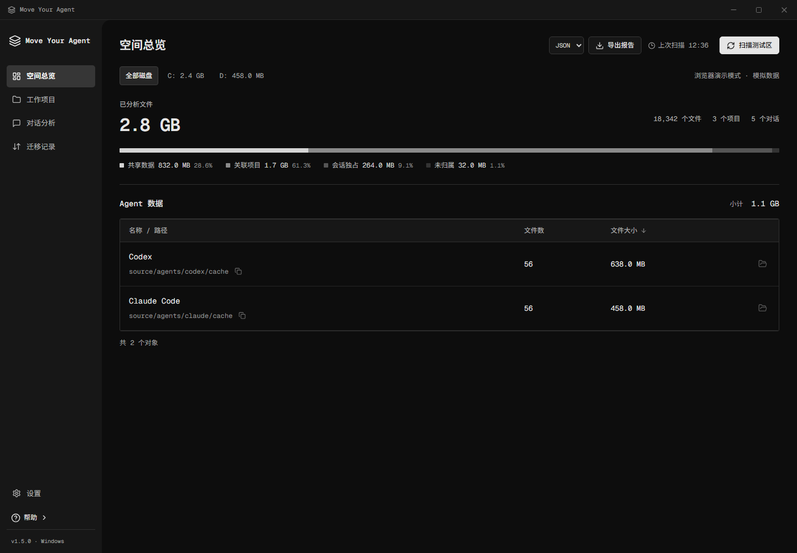

# Move Your Agent

Windows Agent 空间分析与目录迁移工具，1.5.0。Tauri 2 + React + TypeScript + Rust + SQLite。

[下载 Windows x64 便携版](https://github.com/buareaft/MOVE-THE-AGENT-FROM-C/releases/latest)

解压便携包，双击 agent-space.exe。需要 Windows x64 和 WebView2，无需安装 Node、Rust 或字体。保留同目录的标记文件和 CLI。

启动读取已有索引；首次启动为空，点击“扫描本机”后读取 Codex、Claude Code、DeepSeek Harness 的会话元数据、目录和项目文件属性。没有硬件类型检查、机器登记或专用运行环境开关。

总览支持磁盘筛选与 Agent 小计；项目和对话支持搜索、排序、分页、路径复制及定位。共享、项目关联、会话独占、未归属分别统计，按文件身份去重；不把共享数据库平均分摊到对话。云端聊天不计入本地会话，不解析凭据或消息正文。受限目录和未知格式显示扫描提示。

迁移仅支持固定适配器：Codex sessions、archived_sessions、桌面 bin/runtimes，Claude projects，DeepSeek Harness sessions/cache。选择已存在的本地 NTFS 目标目录，退出相关 Agent，预览后确认迁移。复制、校验和切换入口后保留原副本；核对结果后“验证并清理副本”。“恢复原位置”使用目标上的最新数据，源盘需有足够空间。取消或中断后可继续或恢复。同盘迁移不释放源盘空间。

DeepSeek Harness 默认识别 `%USERPROFILE%\.dsh`，支持当前进程的 `DSH_HOME`（绝对路径或当前用户 `~` 路径）。支持 JSONL 和 `.jsonl.zstd` 会话头 v0–v4，同一会话的历史代文件合并显示但保留实际字节统计；未知、损坏或歧义格式计入未归属并提示。不会执行 Harness 配置文件、解析消息正文或移动整个配置/凭据目录。自定义插件的其他会话根目录和 Electron 外部缓存暂不自动发现。[适配说明](docs/DEEPSEEK-HARNESS.md)。

程序拒绝未知链接、硬链接、附加数据流、稀疏/加密文件、网络路径及来源/目标重叠。单次扫描与迁移上限 100000 文件。项目代码仓库仅分析，不整体迁移；不提供任意目录删除或单条数据库会话移动。

左下角“设置”保存默认迁移目标。可选普通目录，或动态 VHDX：镜像默认 D:\MoveYourAgent\AgentData.vhdx，64 GB 上限，挂载 V:\AgentData。保存 → 创建并挂载 → 启用自动挂载 → 到迁移页预览和确认。仅创建和初始化本程序新建、身份匹配的镜像；不覆盖已有镜像，不更改被占用盘符。磁盘管理操作需要当前 Windows 用户的管理员授权。

原路径通过目录联接持续写入目标，应用无需常驻。VHDX 重启后需要重新挂载；登录任务可自动挂载，但无法保证早于其他自启动 Agent，启动 Agent 前请确认挂载状态。设置页分别显示虚拟卷可用空间、镜像大小和镜像所在卷可用空间。镜像放在 C 盘不会释放 C 盘实际空间。存在迁移引用时禁止卸载或关闭自动挂载；先恢复原位置。镜像和所属记录应一起备份，当前不提供移动、扩容、压缩或删除镜像。

报告为完整扫描的 JSON/CSV；本程序索引、设置、迁移记录和界面缓存保存在便携目录的 .lab/agent-space。普通扫描及目录迁移不需要管理员权限，目标目录须可写；虚拟磁盘管理单独请求提权。

字体已内置 Geist Mono 与 Noto Sans SC，许可随包附带。[字体说明](docs/FONTS.md)。

开发主机仅使用生成样本，浏览器始终是模拟数据。npm run desktop 和 npm run cli 默认传入 --fixtures；不要在开发主机启动生产版扫描。开发与构建步骤见 [CONTRIBUTING.md](CONTRIBUTING.md)，测试范围见 [docs/TESTING.md](docs/TESTING.md)。
